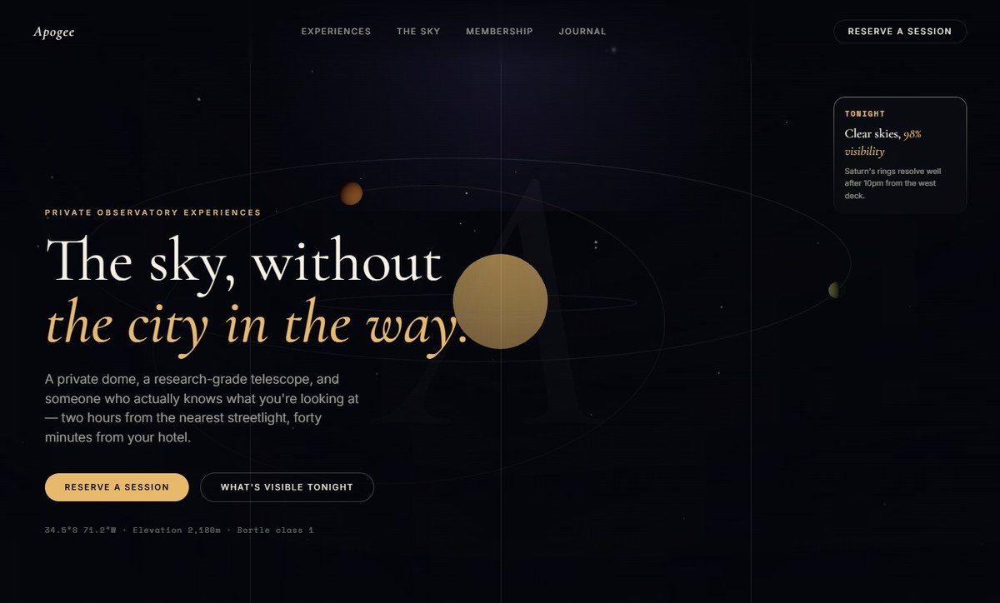
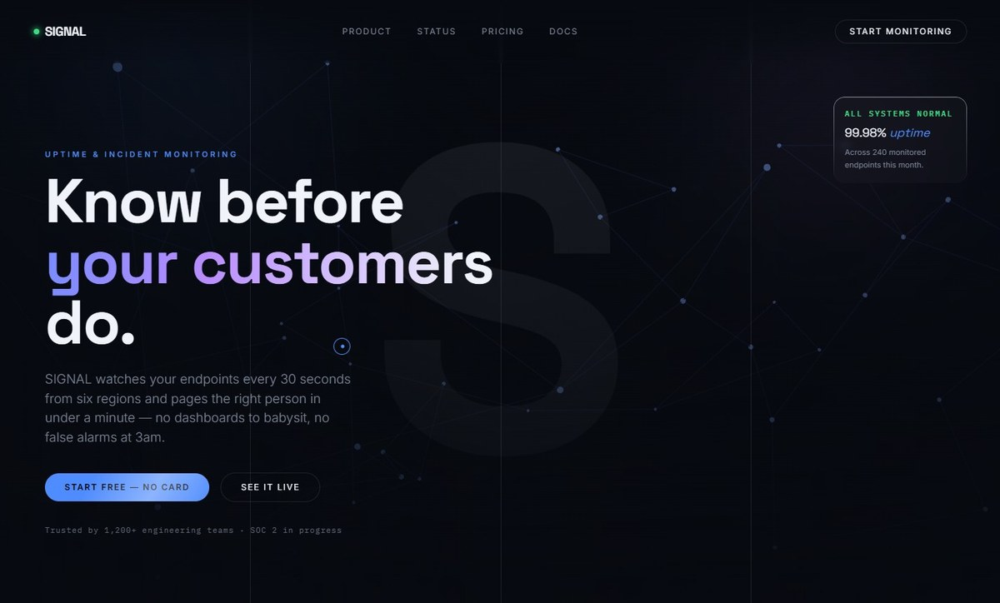

<p align="center">
  
</p>

<h3 align="center">A Claude Code skill for 3D hero scenes whose form and motion come from the site's subject.</h3>

<p align="center">
  
  <a href="LICENSE"></a>
  
  
  
</p>

<p align="center">
  <a href="#whats-here">What's here</a> ·
  <a href="#the-same-skill-two-different-heroes">Examples</a> ·
  <a href="#using-this-skill-in-claude-code">Install</a> ·
  <a href="https://github.com/Flaeren">GitHub: Flaeren</a>
</p>

<p align="center">
  
</p>

A Claude Code skill for building high-end interactive 3D websites — WebGL hero scenes, scroll-driven camera moves, product-style renders — using Three.js, React Three Fiber, drei, and GSAP ScrollTrigger. Complements the `frontend-design` skill: that one covers general UI/UX craft, this one covers the 3D/WebGL implementation layer and the CSS/motion dressing around it.

This repo is the skill's reference material plus two working example builds, kept as evidence that the skill actually produces different, on-brief results rather than one reskinned template.

## What's here

```
SKILL.md              entry point — routes to the right reference file for the task at hand
reference/             the skill's actual content, one focused file per concern
mock-up/               two full example sites built under this skill
```

### `reference/`

| File | Covers |
|---|---|
| `concept-to-form.md` | **Read this first for any new hero scene.** Deriving the hero object's form and motion from the site's actual subject instead of defaulting to a generic polyhedron — includes a self-observed anti-pattern and a subject → form → motion starting table. |
| `three-core.md` | Three.js mental model — scene, camera, renderer, mesh, lights. |
| `r3f-drei.md` | React Three Fiber + drei, the React-side stack. |
| `gsap-scroll.md` | Scroll-as-playhead pattern for camera/object animation. |
| `performance.md` | `InstancedMesh` vs. merged geometry, the decision that matters most at scale. |
| `patterns-and-antipatterns.md` | Synthesis file — the recipe behind most premium 3D hero sites, and the real perf/correctness failure modes (including a genuine "canvas stuck at 300×150" bug found and fixed during this repo's own builds). |
| `retrofit.md` | Adding 3D to a site that already exists, without breaking it. |
| `hero-dressing.md` | The CSS/motion layer around a hero — glass cards, staggered entrance, aurora backgrounds, fluid type, `prefers-reduced-motion`. |
| `micro-interactions.md` | Site-wide polish — nav underlines, button/card hover feedback, sheen sweeps, tilt/magnetic cursor-following elements. |
| `state-and-feedback.md` | Feedback tied to application state, not the cursor — loading skeletons, selected/locked states, number reveals, custom cursors, ticker tape. |

Sourcing is mixed and flagged per file: some content is distilled directly from official docs (threejs.org, r3f/drei/gsap docs), some from real production prompts, some from two real production codebases the patterns were confirmed against independently, and some — `concept-to-form.md` — from a mistake this skill actually made and got corrected on, in the open.

### `mock-up/`

Two sites, same skill, deliberately different subjects — the point is that the *shape and motion of the hero scene changes with the brief*, not just the color palette.

#### The same skill, two different heroes

| SIGNAL: a network that watches itself | APOGEE: an orbit that obeys physics |
|:---:|:---:|
|  |  |
| Uptime monitoring SaaS. Cool blue, a graph of nodes. | Private observatory experiences. Warm gold, real Kepler motion. |

- **`signal-mockup`** — SIGNAL, an uptime/incident monitoring SaaS. Hero is a network graph (monitored endpoints as nodes, topology as edges), each node drifting on its own independent phase — calm at rest, a single node flashes red on an interval to represent an incident being caught.
- **`apogee-mockup`** — APOGEE, private observatory experiences. Hero is an actual orbital system: planet position comes from the polar ellipse equation, angular speed from `dθ/dt = L/r²` (conservation of angular momentum), so bodies genuinely move faster near periapsis and slower near apoapsis — not a hand-tuned ease. Background stars are static on purpose: unlike the network graph, the real referent (distant starlight) doesn't move at any timescale a viewer would notice.

Both are Vite + React + TypeScript + Tailwind v4 + `@react-three/fiber`/`drei` + GSAP. To run either:

```bash
cd mock-up/<name>
npm install
npm run dev
```

## Using this skill in Claude Code

Copy `SKILL.md` and `reference/` into `~/.claude/skills/immersive-3d-web/` (or wherever your Claude Code skills directory lives). The skill activates automatically when a task matches its description.

## License

MIT, see [LICENSE](LICENSE).

---

<p align="center"><sub>Made by Gabriele Denaro · <a href="https://github.com/Flaeren">GitHub: Flaeren</a> · <a href="https://gabrieledenaro.com">gabrieledenaro.com</a></sub></p>
